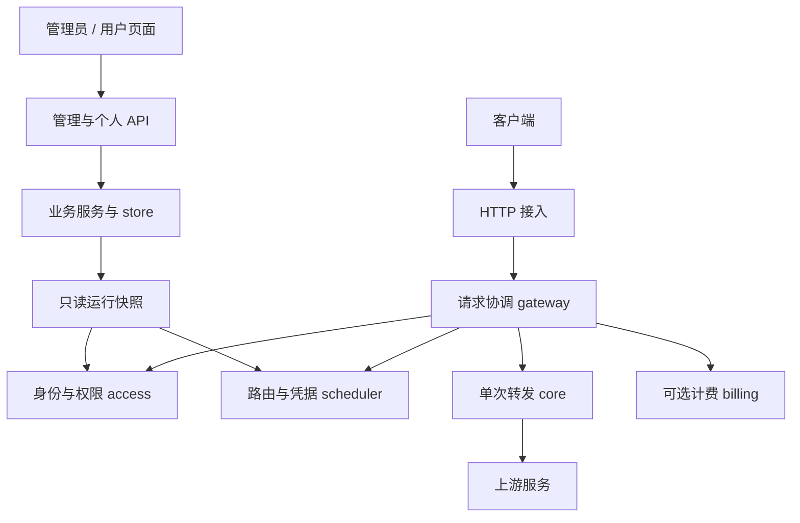

# 架构设计：极简内核、统一框架与功能模块

状态：2026-10-17 按架构优先更新的目标与边界，尚未全部实现。任务状态以 [PLAN.md](PLAN.md) 为准，命令和目录操作以 [DEVELOPMENT.md](DEVELOPMENT.md) 为准。历史验收证据见 [归档](history/acceptance-s0-s5.md)，不维护第二份活动计划。

S0–S4 与 F0 已通过阶段验收；S5 已实现定点账本、管理员对账与强杀恢复批次，完整成本上界仍待闭环，尚未完成完整阶段。最新顺序为底层架构验收 → 功能补全，S5 的安全约束保留且计费证明单独验收：**S6 先收口统一兼容与协调框架，S7-A 再接入 Responses HTTP/SSE、持久会话、后台任务和 WebSocket**。这些是必须开发的目标，不是已有功能；支付不在本轮范围。多团队协作与现有接口见 [COLLABORATION.md](COLLABORATION.md)，HTTP 契约见 [openapi.json](openapi.json)。

## 设计总纲与当前差距

项目中心是 **极简执行内核 → 统一兼容与协调框架 → 按需功能模块**，不是某一个厂商、Responses 产品或功能大全。统一的是生命周期、能力与执行契约，不是所有协议共用一个巨大 DTO；兼容必须落实到具体操作、源/目标协议、传输、客户端版本和计费模式。

| 层次 | 最终职责 | 当前代码与缺口 |
|---|---|---|
| 极简执行内核 | 单次 I/O 尝试、取消/超时、响应提交事实与执行结果 | `internal/core` 已实现标准库 HTTP 执行；不含 WS |
| 统一请求协调 | 授权、准入、路由/attempt、重试、预算、统一收尾 | `internal/gateway` 已抽离非 Gin 协调函数与 `core.Output` 输出端口，现有 HTTP 实际复用；保留 HTTP/Gin 适配，以 `LegacyBilling`/`StrictBilling` 消费原账本；无 native WS/持久 worker 入口 |
| 统一兼容契约 | 按操作的语义模型、能力约束、usage/结果、传输边界 | Chat/embeddings 有各自载荷与不可变操作信封，类型化能力进入路由和准备，embeddings 独立解码；独立 Responses 模型未接生产，完整矩阵未验收 |
| 功能模块 | 身份、调度、可选计费、观测，以及后续状态型应用 | 前几项已有实现；Responses、持久会话、后台任务均待开发 |
| 接入与基础设施 | HTTP/SSE/WS、持久实现、控制台、显式组装 | HTTP/SSE、SQLite、内嵌控制台已实现；A3-01 增加有界进程内 worker，A3-02 增加其可选加密输出记录，A3-03 增加独立 WS transport 与实际 socket 消费回归；A3-04 增加加密任务意图+双预算原子受理与未执行回收；产品 WS、完整状态服务与生产持久 worker 待开发 |

已有内核边界没有因后续规划失效；需要纠正的是框架尚未完成就让状态型功能主导接口设计的顺序。F0 只是初始可协作基线，不等于上表的统一兼容框架已经验收。S6 用现有生产 HTTP 消费者证明入口收敛，再让 S7-A 消费；不能只建立空接口宣称框架完成。

### 统一框架的最小契约

以下是设计约束，不预先固定所有 Go 类型、目录或公开 SDK：

| 契约 | 需要统一 | 不强行统一 |
|---|---|---|
| 执行信封 | 可信身份/owner、操作、模型、请求标识、截止时间与取消、所需能力 | 不把持久正文、全部厂商字段放进通用 context |
| 操作与能力 | 各操作的输入/输出/事件、同协议保真策略、不可表示语义的拒绝、计费支持范围 | Chat、embeddings、Responses 不是同一个 ChatRequest；透传不是全功能保证 |
| 执行结果 | attempt 与请求汇总、已提交事实、终止原因、usage 完整性与原始计量维度 | 协议完成不等于财务 settled；未知执行不等于未执行 |
| 生命周期与端口 | 授权/准入、调度、执行、预留/结算、取消/释放的责任；确有需要的消费侧小接口 | 不建巨型 interfaces 包，不为每个函数增加插件钩子 |
| 状态型扩展 | 持久作用域/幂等、任务领取和恢复、一致性事务的最小端口 | 会话、任务、连接、生成轮次不是同一生命周期；不预建通用分布式任务平台 |

目标调用方向为：HTTP 生成入口或状态型应用 → gateway → 协议/调度/计费及执行端口；状态型应用通过持久端口访问存储，`cmd/gateway` 注入具体实现。gateway 不反向依赖 Responses 应用，不直接依赖 server/store；协议不依赖用户/账本；core 不依赖业务。状态型应用可先完成 owner/状态校验，但每次实际生成仍经过 gateway 的可信授权与准入，worker 不能获得旁路权限。

HTTP 与 WS 可以采用不同的纯传输执行器，统一的是 gateway 的业务协调。WS 库留在独立 transport，不塞入标准库 core；能力声明、具体端口与依赖约束在真实调用批次一起评审。同进程模块是可信代码，不是可隔离不可信扩展的安全沙箱，也不是动态加载插件系统。

## 1. 确定的边界

身份只有 `admin` 和 `user`。所有渠道由管理员统一配置；普通用户获得模型使用权并创建自己的访问密钥。不建设组织、工作空间、成员关系或多级角色系统，不引入 `tenant_id`。

采用模块化单体：一个 Go module、一个进程、一个二进制起步。模块之间普通函数调用，通过少量接口替换确有变化的能力。性能优化依据基准，不通过提前拆微服务或动态插件平台实现。

内核只执行一次上游转发；请求协调层组织一次完整用户请求。用户、权限、预算和渠道调度均在内核外，生产 HTTP 入口始终经过鉴权与协调层。

## 2. 系统结构

下图表示当前 HTTP 主干及其职责方向；第 12 节是基于统一框架的未来状态型扩展，不应把两个图示层次混作已实现能力。

图中不表示都需要网络通信。协议适配器实现内核使用的转换接口，由组装代码注入。统计和日志消费请求结果，不直接决定内核行为。

| 模块 | 职责 | 禁止承担 |
|---|---|---|
| `core` | 单次转发、连接复用、流式读写、超时取消、结果与提交状态 | 用户、价格、数据库、渠道优先级 |
| `gateway` | 授权、准入、调度、重试、完成与释放的固定顺序 | 各业务模块内部算法、厂商协议细节 |
| `protocol` | 协议能力检查、请求/响应转换、每请求流式状态 | 用户与数据库操作 |
| `access` | 登录与 API Key 身份、用户/密钥权限、管理角色、准入限制 | 上游读写 |
| `scheduler` | 模型路由、凭据选择、失败冷却、可选亲和 | 扩大已授权的模型范围 |
| `billing`（可选） | 价格、额度预留、幂等结算和对账 | 依赖普通访问日志完成可靠记账 |
| `server` | HTTP 路由、输入输出、管理与个人 API | 写入复杂业务规则 |
| `store` / `config` | 持久化与迁移、启动配置、运行快照 | 被 core 直接调用 |

模块内部先用少量文件组织。只有职责和规模确有需要时再分包，不预先为每个名词创建目录；日志也先是小型组件，不先建设事件总线。

## 3. 最小用户与数据模型

| 实体 | 核心字段与约束 |
|---|---|
| User | id、username、password_hash、role、status、模型权限、速率/并发限制 |
| Token（对外称 API Key） | id、user_id、key_hash、key_prefix、name、status、expires_at、模型限制、速率/并发限制 |
| Channel | 上游类型、base_url、支持模型、映射、优先级、权重、启用状态；全局由管理员管理 |
| Credential | channel_id、受保护的上游密钥、权重、状态和健康信息 |
| RequestLog / AttemptLog | 内部请求 ID、user_id、token_id、尝试序号、渠道/凭据 ID、用量、耗时和终止原因 |
| 可选账务记录 | 价格版本、用户/密钥预算、预留、结算流水 |

先保留数据库 `tokens` 命名，避免只为命名迁移数据。能力表是路由索引，不是权限表；用户授权必须单独校验。现有 `group_name` 暂保留兼容，不再发展成用户组织或分组倍率系统，删除字段需要独立迁移。

客户端 API Key 由服务端生成足够随机的值，仅创建时返回一次；当前已存储验证摘要和展示前缀，不保留可查询的明文。上游凭据需要恢复原值用于转发，目标是单独加密存储并保护主密钥，不能与客户端 key 混用同一存储方式。

**当前缺口**：`model.Credential.APIKey` 由 store 直接保存，尚未实现静态加密；管理响应的掩码只保护展示。需单独安排主密钥注入/轮换、加密迁移与备份恢复的安全加固批次，本次不改数据。后续持久正文同样必须独立落实加密，不能把此处的目标要求写成已完成保证。

## 4. 管理员与普通用户的权限

| 操作 | admin | user |
|---|---|---|
| 创建、停用用户，修改角色 | 允许 | 禁止 |
| 管理渠道、凭据、全局设置 | 允许 | 禁止 |
| 设置用户可用模型、上限与预算 | 允许 | 禁止扩大自身权限 |
| 创建/吊销自己名下 API Key | 允许 | 允许，限制不超过自身授权 |
| 查看调用日志与统计 | 可查看全局 | 仅本人 |
| 调用模型 | 使用合法 API Key，按该 key 与用户授权检查 | 相同 |

管理会话和模型调用凭证分开。管理员登录后的管理权限不让其任意一把调用 key 自动绕过模型限制。首次管理员通过一次性初始化命令/环境输入创建，禁止默认公开密码；阻止删除或停用最后一个有效管理员。

API 目标分区：`/api/admin/*` 为管理员操作，`/api/me/*` 为个人资料、自己的密钥与用量，`/api/auth/*` 为登录会话；`/v1/*` 等协议路由处理模型请求。旧 `/api/channels` 等接口在迁移期必须先受管理员鉴权保护，再移除或兼容重定向，不能留下未保护的旁路。

权限规则：

- 实际可用模型 = 系统启用模型 ∩ 用户授权 ∩ key 限制。模型映射和备用路由不得扩大集合。
- 用户、key 均启用且未过期，才可调用；停用用户同时使其所有 key 的新请求失效。
- 用户与 key 的并发、速率、预算限制分别生效，不能只验证 key。
- 显式区分 `all` 和 `allowlist`；空 allowlist 表示无授权，不用空数组表达两种含义。
- 普通用户的 user_id 来自可信身份，忽略或拒绝客户端试图指定其他 owner 的操作。
- 查询个人 key/日志时必须在业务层和数据库查询中限定 user_id；不能仅靠页面隐藏按钮。
- key 创建、模型列表和实际调用使用同一个权限计算函数。

现有无归属 token 的迁移需要管理员明确指定 owner；不要把 user_id=0 当成永久匿名超级用户。

## 5. 请求生命周期

1. 生成服务端内部唯一 ID；外部 Request ID 只用于日志关联。
2. 识别 key 与所属用户；限制请求大小，提取模型/操作/流式偏好。
3. 检查用户和 key 权限，获得只读授权上下文。
4. 执行用户/key 的速率与并发准入；当前立即拒绝，不排队。若以后确有排队需求，必须短、有界、可取消。strict 使用持久原子预留；legacy 不具有相同保证。
5. scheduler 在授权候选中选择渠道和凭据；protocol 检查该目标是否能表示请求能力。
6. core 执行一次转发并返回 AttemptResult。
7. gateway 根据错误分类和剩余预算决定是否重试，更新健康状态。
8. 统一收尾：释放并发/凭据资源、保存结果、结算或可靠标记待处理。异常与取消也必须走收尾。

现有身份使用类型化 context，请求与 attempt 结果分离，不依赖 Gin 字符串键传递业务身份；本轮 gateway 已将共用执行信封/结果与 Gin HTTP 适配分开，Chat/embeddings 真正复用同一协调函数；公开 Execute 要求可信身份并逐次建立准入状态。`protocol.Request` 将操作、载荷投影、原始正文和能力需求绑定，准入/attempt/结果记录同一 Operation；每次准备使用正文和目标元数据副本，旧 Mode 不能替换操作语义。当前通过 `core.Output` 的 Commit/Write/Flush/State 输出，标准 HTTP writer 仅由 HTTP 适配器持有；A3-01 的 `internal/generation` 已作为有界进程内 worker 真实调用同一入口并重新解析派发身份，A3-02 又为它增加可选加密输出记录和中断标记；A3-03 的真实 socket 消费者验证同一执行链与独立连接容量；A3-04 通过 IntentAdmission 小端口原子保存加密意图和原账本双 hold，但不把意图接入 Runner，不授予 attempt 权限；没有生产后台接线、领取/任务恢复重派或 native WS。JSON/SSE 字节仍非通用协议事件，S6 未完成阶段验收。

## 6. 内核契约与重试边界

当前 core 通过 `Executor.ExecuteTo(ctx, output, input)` 接收单次 HTTP 输入与 `core.Output`，返回 `core.Result`；原 `Execute(ctx, writer, input)` 为 HTTP 适配入口。输出由调用者持有，一次 execution 独占，不能重复使用已提交出口。Commit 必须报告不可逆提交，Write/Flush 同步且有界、遵守取消；短写作为失败。HTTP 使用标准 ResponseController 转发 flush/write deadline；非 HTTP 输出的 HTTPStatus 保持 0。此端口仍承载已编码正文，不将 SSE 字节称为原生 WS 事件。下表为契约语义，具体字段以代码为准；未来扩展不等于全部输入项已有独立配置。采用标准库 HTTP 原语和少量必要封装，不另造一套完整 HTTP 框架。

| Attempt 输入 | Result 输出 |
|---|---|
| 目标 URL、方法、必要请求头 | 上游状态与错误分类 |
| 原始请求体或可重放来源 | 已发送/接收字节、是否可确定上游未执行 |
| 单次协议转换会话 | 是否已提交客户端响应 |
| 连接/响应头/空闲/总时间和报文上限 | 首字节/结束时间、终止原因、usage 完整性 |

core 不能 import Gin、GORM、access、scheduler 或具体厂商适配器。接口由消费它的模块定义，实现方依赖接口；避免为解决导入环创建庞大的全局 interfaces 包。

重试仅在响应未提交、请求可重放、错误策略允许、总截止时间和尝试次数仍有余量时执行。core 的响应提交状态不可由扩展重置。网络超时不证明上游未执行，未知执行结果可能重复收费，应单独设策略。客户端取消后不继续重试。

每条流的转换状态直接属于该次请求，不以客户端 Request ID 查找共享可变对象。已发 HTTP 200 但流异常时，记录独立终止状态，并按客户端协议表达错误；不能伪装正常结束或补上成功标记。

## 7. 协议与性能

目标是同协议保留可保真的原始字段，做必要的路由/模型改写和 usage 观察；跨协议才建立相应语义对象。鉴权、资源限制与 strict 能力检查始终适用，不承诺未知字段无条件透传。本轮已为 Chat/embeddings 引入独立载荷与共享信封，操作能力同时约束路由和发送准备；embeddings 原生字段/usage 保留，不经 Chat 转换或生成 SSE 终态。`ProtocolAdaptor` 明确是 Chat codec，不再作为所有操作的公共载荷接口。Responses 仍使用独立样本模型，后续接线必须经对应操作验收，不能强塞进 ChatRequest。

能力不对等时明确拒绝或配置可见的降级。未知关键字段不能静默丢弃。大请求的重放使用有限内存/临时文件，或显式禁用重试；流式响应不能无限缓冲。

性能重点：复用 Transport、减少 JSON 重复解析、模型索引查找、按请求读取一次配置快照、每流资源有上限、取消后及时关闭连接。普通指标按请求/尝试更新，不对每个 token 执行全部扩展。

先测吞吐、额外首字节延迟、chunk 延迟、p95/p99、分配量、每流内存及取消释放时间；有基准证据再引入对象池或进一步缓存。优化不得损害流内容完整性。

## 8. 配置、缓存与故障策略

写数据库 → 校验并编译新版本 → 原子发布只读快照。管理端区分“已保存”和“已应用”，发布失败不能返回假成功。每请求持有稳定快照；脱敏响应使用独立 DTO，不修改运行缓存。

配置、实时健康/并发计数、永久账本分别维护。发布配置不应清空在途租约或错误地恢复冷却凭据。

单实例停用用户/key 后的新请求应及时拒绝；是否取消已有流作为明确产品策略。将来多实例再定义最大吊销传播窗口、失联策略与版本同步，当前不建设分布式配置平台。

鉴权、权限、严格预算失败时拒绝新请求；无可用渠道返回明确错误。普通日志故障使用有界队列降级并记录丢弃计数，不能阻塞所有转发。

## 9. 调度与可选计费

调度顺序固定为：授权过滤 → 模型/协议能力 → 渠道优先级 → 同级分配 → 可用凭据。每次尝试选择凭据，不在加载时永久绑定一把 key。

健康状态按错误语义分类；不能把任意 400 都归咎客户端，也不能把全部 403/429 都当永久坏 key。当前已有加权选择、冷却、拉黑/恢复与默认关闭的可选亲和，半开探测等后续按实际需求决定。亲和按可信 user_id 与会话键作用域隔离，不把简单取模称为一致性哈希，也不保证更换 key 的缓存命中率必为零。亲和只优化目标选择，不保存可重启恢复的会话，不保证真实缓存收益；开关和测量边界见 [开发指南](DEVELOPMENT.md#s3-并发准入与用户请求速率)。

计费是可选模块，自用可显式关闭。启用时采用原子预留 → 实际结算 → 释放差额，金额使用定点/整数单位。用户和 key 双层预算在同一一致性边界内检查，不能先分别查询再扣。

无价格、usage 缺失、客户端取消、上游执行不确定均有明确状态和策略；收费模式不能静默按零计费。严格预算需要预留覆盖允许的最大费用，只有平均估算不能保证不超额。账本与普通访问日志分开，使用幂等结算键和崩溃恢复，不承诺跨上游与数据库的绝对一次执行。

S5 首批以整笔配置的单次用户收费上限作为预留，而不是只估算输出 token。输入、输出与渠道倍率使用同一不可变价格版本；实际合计超过预留则保留待对账，不补扣突破用户预留，也不称为厂商成本绝对上界。文本之外的未知计价项暂时拒绝。兼容模式 `legacy` 保留可用性优先行为，不具备上述严格保证；具体限制、恢复路径与待交付项见 [开发指南](DEVELOPMENT.md#s5-定点价格与严格结算首批)。

## 10. 扩展和部署

第一版只保留真正需要替换的端口：身份/授权、调度、协议、可选结算与观察。其余用直接函数调用。没有功能需求时不创建空模块、空接口、全局事件总线或动态插件注册中心。

扩展明确 Context、并发安全、错误和关闭规则；同进程扩展是可信代码，不能宣称能隔离任意死锁或内存耗尽。

默认单二进制、单实例、SQLite。数据库实现封装在 store，可按实际需要接入一种外部数据库；不强制捆绑数据库、Redis 或反向代理。需要独立升级或多节点容量时，再拆控制面与网关，并处理全局预算/限流和快照一致性。

core 先放 `internal/core`，在同仓稳定后再考虑公开 Go 包或独立仓库，避免过早承担外部 API 兼容承诺。

## 11. 开发约束

1. 新增用户页面、权限规则或计费策略不应要求修改 core。
2. 一份配置只维护一个可信来源，一项行为只在一个模块实现。
3. 新接口必须对应真实调用方和可替换需求；不为远期猜想做抽象。
4. 一次变更聚焦一个行为或目录调整，避免重构、重命名和功能扩张混成大提交。
5. 文档只维护一份活动计划；废弃方案明确标为历史，验收证据独立归档或通过 Git 追溯，不保留互相矛盾的活动规格。

## 12. 首组状态型扩展：Responses 持久执行

状态：2026-10-16 确认的 S7-A 目标，不是已实现能力；批次与验收以 [PLAN.md](PLAN.md#s7-aresponses-持久执行主线) 为准。它是统一框架的首组状态型消费者，不定义整个项目的中心。持久会话、后台任务和 WebSocket 均必须交付，不能以现有亲和缓存或 HTTP 接口替代。首个完整组合使用标准 API Key 和经验证的原生 Responses 上游。

### 12.1 分层与真实复用

| 层 | 目标职责与依赖 | 不承担 |
|---|---|---|
| server | HTTP/WS 鉴权边界、协议 DTO、查询/取消/会话入口 | 后台 worker、重复预算或迁移逻辑 |
| generation（A3-01/02/04 最小消费者） | 有界进程内交接、派发前解析可信绑定、调用 `Gateway.ExecuteTo`、可选加密输出记录；独立 IntentAcceptor 经小端口原子持久受理/未执行取消 | 意图派发、公开后台 API、完整持久任务/事件、重启重派、独立账本；当前 main 未启动 |
| responses 应用服务（按需新增） | 持久上下文、任务/事件生命周期，调用 gateway 的生成入口；使用 access/gateway/model/protocol 与持久端口 | 直接依赖 store/GORM、自己重新实现上游生成与计费 |
| gateway | 统一操作准备、授权、准入、调度、attempt、预算、生成收尾；消费执行与持久端口 | 直接依赖 responses 应用服务、store 或框架任务队列 |
| protocol | Responses 请求/item/事件与能力、usage 解析 | 数据库、连接池、worker 和模型调用 |
| core | 保留标准库单次 HTTP 执行，复用已有生命周期 | WS 库、会话/任务/用户逻辑 |
| WS transport（A3-03 已有基础） | 纯 I/O、消息/容量边界、deadline、关闭；当前由测试应用调用，产品原生 WS 执行端口仍待接线 | 用户、账本、数据库、协议业务事件含义；不能绕过 gateway 执行 |
| store / billing 持久实现 | 会话/任务/事件与现有账本的一致性事务，版本/幂等约束 | 以访问日志恢复状态、向业务层暴露任意 GORM 事务 |
| cmd/gateway | 实例组装、worker/WS 管理器启动与有序关闭 | 在包 init 中隐式启动服务 |

S6 先让现有 HTTP 成为类型化执行入口的真实调用者并验收合并；S7-A01 接入 Responses，后续再接 worker/WS，共享规则只有一个实现。新增模块、WS 依赖与跨模块原子提交端口需连同 `internal/architecture` 边界和真实行为测试评审，禁止为了引入新包删除/放宽全部依赖门槛。纯 WS I/O 与 HTTP core 可用不同执行器，但两者都由 gateway 组织 attempt，不产生第二条业务链。

后台接收需要任务意图和账本预留在同一存储事务中成功；S7-A01 明确最小事务端口与失败语义，S7-A03 交付真实调用和故障回归。不能先扣余额后异步写队列，也不能先返回任务 ID 后再尝试预留。A3-04 已用现有 Chat/embeddings 的加密输入真实消费此原子端口并验证强杀前后事务；只是短期、不可执行的意图回执，不是 Responses job。原账本拒绝以该回执开启普通 attempt；领取/续租/fencing、持久价格/能力恢复和原生上游策略须后续独立验收。

### 12.2 持久模型与上下文权威

以下为逻辑实体建议，不预占表名或 schema 版本；最终由存储/集成批次决定最小迁移，沿用现有 runner。

| 逻辑实体 | 必须保存的事实 |
|---|---|
| Response | 本地公开 ID、内部生成 ID、可信 user_id/创建 token_id、操作/请求摘要、父 ID 或 conversation ID、状态、模型、上游绑定、价格版本、billing ID、存储策略/过期时间 |
| Conversation / Item | owner、顺序/修订号、输入/输出与工具关联、元数据、加密内容、创建/删除/过期状态；追加采用条件版本或明确分支 |
| Upstream binding | 公开 ID 到上游 response/conversation ID、渠道/凭据及状态来源模式的映射；不在响应中泄露凭据 |
| Response job | 幂等键/请求摘要、任务意图、上游受理 ID、领取/续租与 fencing 版本、截止时间、取消请求、恢复/失败原因及账本关联 |
| Response event | response ID、单调事件序号、事件类型/加密内容、终态标记和过期时间；唯一约束防重复提交 |

优先以本地持久历史为权威，同时记录原生上游映射。一条生成必须明确是上游原生父链还是经验证的本地完整重放，不能同时携带两份历史。无法重建的加密推理/工具项保留不透明语义并维持原生绑定；不能删掉后声称无损续链，也不能跨到不认识父 ID 的账号静默重试。

每次引用会话/response 都检查 owner、创建 Key 绑定、当前 Key 状态和模型权限；默认不允许同用户其他 Key 仅凭 ID 读到内容。显式更换 Key 的数据授权留作独立策略，不使用客户端 user_id、会话头或上游 ID 作为可信身份。后台 worker 从可信持久任务恢复身份并校验，不能以管理员角色代替原用户执行。

续链成本包括实际历史、工具定义/结果及启用的其他维度。每个生成轮次用不可变价格版本单独预留/结算，不因只传增量而只估算增量，不让长连接或后台任务持有可无限消费的额度。

### 12.3 后台状态、事件与不确定执行

内部任务流程为 queued → dispatching → in_progress → completed / failed / cancelled，取消请求与执行不确定另作显式标记；公开 Response 状态使用核对后的官方枚举。协议终态与财务终态分离：生成已结束仍可能 billing pending。

接收任务时原子提交预留和任务意图；worker 领取后有续租、fencing token、最大运行时间、重试/轮询上限和在途配额。排队不持有网络 attempt 槽，已受理的远端任务不能因本地轮询结束就认为不占后台容量或可退款。

客户端断开不会取消显式 HTTP 后台任务；worker 的执行 context 属于服务/任务生命周期。网关重启后用持久上游 ID 继续查询或恢复事件。若上游已受理而 ID 未落库，除非上游幂等能力已验证，否则只能保留不确定与预算占用，不盲目重新提交。租约失效不是远端未执行的证据。

取消通过持久 cancel_requested、上游请求/确认和条件版本处理；取消与完成/usage 竞争不能重复结算或返还。取消确认不等于零成本，后台读取/恢复也不产生新的生成账单。账户停用或 Key 撤销后停止新派发，并按明确的撤销策略请求取消在途任务，未确认的成本仍保留。

可恢复事件不走普通可丢日志。先提交事件与单调游标，再对外公开可恢复事件；DB 不可写时有界背压/失败，不在内存无限积累。只有以流式创建且仍在保留期内的后台响应支持按游标恢复；超期/缺失明确返回错误，不补造成功事件。读取、轮询和重放单独限速，不能再次调用上游生成或扣费。

### 12.4 WS 连接与持久会话分离

提供 `GET /v1/responses` Upgrade，原生客户端 WS 和原生上游 WS 作为首批必验链路。连接会话只承载传输缓存，不是持久历史的权威；HTTP、WS 与重启后续链均通过同一状态/owner 服务。

握手验证当前凭据；每次 `response.create` 再走用户/Key/模型权限、RPM/并发与严格预算。连接限额、活跃轮次/命名流限额、模型调用限额分别有界，空闲连接不占生成预留。命名流、线程和辅助请求互相隔离，控制事件按所选协议版本映射，不照搬语音 Realtime 的事件集合。

Responses WS 不通过 `background` 参数创建后台任务，HTTP 后台执行与 WS 前台连接是不同生命周期。普通 WS 断开触发当前前台生成的取消/未知结果收尾，不按免费处理；只有显式后台任务脱离观察连接继续。已经提交到客户端的生成不做透明重放；恢复已持久响应/上下文不等于恢复远端未确认的生成。

采用经审查、兼容 Go 基线的单一 WS 库并隔离于 transport；容量、最大消息、读写/空闲超时、心跳、Origin、单写者/关闭并发和错误脱敏必须有回归。Key 不进 URL，连接复用不永久缓存授权。Key 停用传播间隔和在飞轮次的处理需在批次契约中明确。

### 12.5 内容存储、生命周期与关闭

持久正文使用独立主密钥保护，明确注入、轮换与缺失时拒绝策略，不把原始调用 Key 或正文写进日志。`store=false` 的同步请求不落长期历史；后台只按明确告知的短期策略保存恢复所需内容，不能宣称零保留。默认保留期、每用户/实例字节数、事件上限、删除/过期与磁盘满策略在 S7-A02 定稿并验收，不允许无限历史/事件增长。

删除历史与取消生成分开；在途删除按协议及已声明策略处理，不静默放弃任务和预算。财务/最小审计事实不随内容清理级联删除，正文与敏感参数在允许期限后清除。管理员的诊断权限不默认意味着可以读取所有用户正文。

关闭时先停止新接入/派发，再处理已升级 WS 和前台生成，保存任务/事件与必要终态，停止并等待 worker/恢复/清理，最后关闭连接执行器与 store。`http.Server.Shutdown` 不代替 WS 管理器显式关闭；已受理的远端后台任务保留恢复事实，不能为快速退出将其视为未执行全退。
