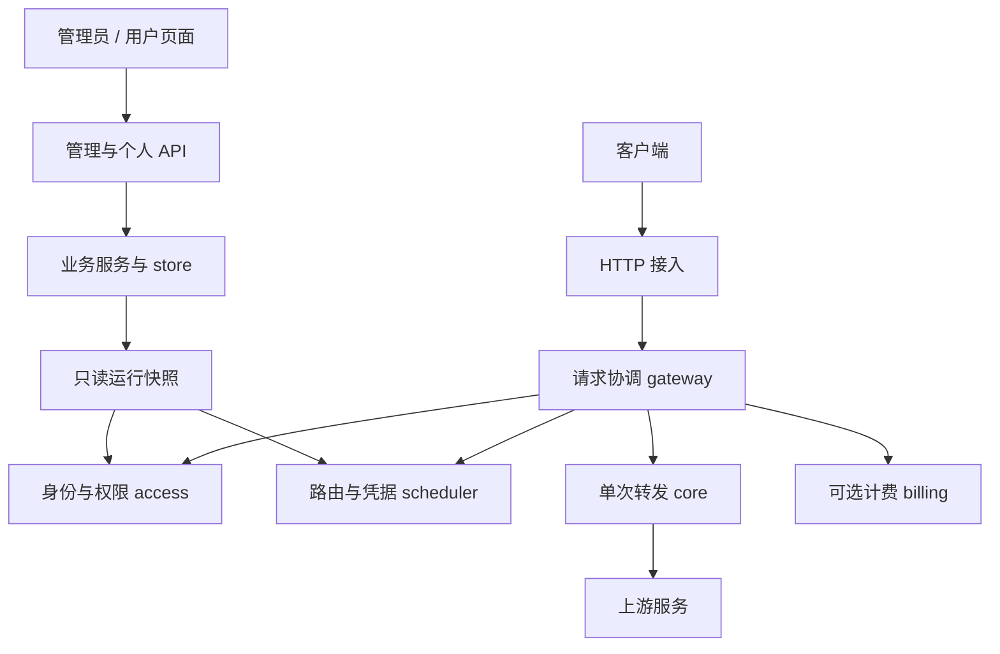

# 架构设计：极简转发内核与管理员—用户系统

状态：目标设计，尚未全部实现。任务状态以 [PLAN.md](PLAN.md) 为准，命令和目录操作以 [DEVELOPMENT.md](DEVELOPMENT.md) 为准。

## 1. 确定的边界

身份只有 `admin` 和 `user`。所有渠道由管理员统一配置；普通用户获得模型使用权并创建自己的访问密钥。不建设组织、工作空间、成员关系或多级角色系统，不引入 `tenant_id`。

采用模块化单体：一个 Go module、一个进程、一个二进制起步。模块之间普通函数调用，通过少量接口替换确有变化的能力。性能优化依据基准，不通过提前拆微服务或动态插件平台实现。

内核只执行一次上游转发；请求协调层组织一次完整用户请求。用户、权限、预算和渠道调度均在内核外，生产 HTTP 入口始终经过鉴权与协调层。

## 2. 系统结构

图中不表示都需要网络通信。协议适配器实现内核使用的转换接口，由组装代码注入。统计和日志消费请求结果，不直接决定内核行为。

| 模块 | 职责 | 禁止承担 |
|---|---|---|
| `core` | 单次转发、连接复用、流式读写、超时取消、结果与提交状态 | 用户、价格、数据库、渠道优先级 |
| `gateway` | 授权、准入、调度、重试、完成与释放的固定顺序 | 各业务模块内部算法、厂商协议细节 |
| `protocol` | 协议能力检查、请求/响应转换、每请求流式状态 | 用户与数据库操作 |
| `access` | 登录与 API Key 身份、用户/密钥权限、管理角色、准入限制 | 上游读写 |
| `scheduler` | 模型路由、凭据选择、失败冷却、可选亲和 | 扩大已授权的模型范围 |
| `billing`（可选） | 价格、额度预留、幂等结算和对账 | 依赖普通访问日志完成可靠记账 |
| `server` | HTTP 路由、输入输出、管理与个人 API | 写入复杂业务规则 |
| `store` / `config` | 持久化与迁移、启动配置、运行快照 | 被 core 直接调用 |

模块内部先用少量文件组织。只有职责和规模确有需要时再分包，不预先为每个名词创建目录；日志也先是小型组件，不先建设事件总线。

## 3. 最小用户与数据模型

| 实体 | 核心字段与约束 |
|---|---|
| User | id、username、password_hash、role、status、模型权限、速率/并发限制 |
| Token（对外称 API Key） | id、user_id、key_hash、key_prefix、name、status、expires_at、模型限制、速率/并发限制 |
| Channel | 上游类型、base_url、支持模型、映射、优先级、权重、启用状态；全局由管理员管理 |
| Credential | channel_id、受保护的上游密钥、权重、状态和健康信息 |
| RequestLog / AttemptLog | 内部请求 ID、user_id、token_id、尝试序号、渠道/凭据 ID、用量、耗时和终止原因 |
| 可选账务记录 | 价格版本、用户/密钥预算、预留、结算流水 |

先保留数据库 `tokens` 命名，避免只为命名迁移数据。能力表是路由索引，不是权限表；用户授权必须单独校验。现有 `group_name` 暂保留兼容，不再发展成用户组织或分组倍率系统，删除字段需要独立迁移。

客户端 API Key 由服务端生成足够随机的值，仅创建时返回一次；存储验证摘要和展示前缀，不保留可查询的明文。上游凭据需要恢复原值用于转发，应单独加密存储并保护主密钥，不能与客户端 key 混用同一存储方式。

## 4. 管理员与普通用户的权限

| 操作 | admin | user |
|---|---|---|
| 创建、停用用户，修改角色 | 允许 | 禁止 |
| 管理渠道、凭据、全局设置 | 允许 | 禁止 |
| 设置用户可用模型、上限与预算 | 允许 | 禁止扩大自身权限 |
| 创建/吊销自己名下 API Key | 允许 | 允许，限制不超过自身授权 |
| 查看调用日志与统计 | 可查看全局 | 仅本人 |
| 调用模型 | 使用合法 API Key，按该 key 与用户授权检查 | 相同 |

管理会话和模型调用凭证分开。管理员登录后的管理权限不让其任意一把调用 key 自动绕过模型限制。首次管理员通过一次性初始化命令/环境输入创建，禁止默认公开密码；阻止删除或停用最后一个有效管理员。

API 目标分区：`/api/admin/*` 为管理员操作，`/api/me/*` 为个人资料、自己的密钥与用量，`/api/auth/*` 为登录会话；`/v1/*` 等协议路由处理模型请求。旧 `/api/channels` 等接口在迁移期必须先受管理员鉴权保护，再移除或兼容重定向，不能留下未保护的旁路。

权限规则：

- 实际可用模型 = 系统启用模型 ∩ 用户授权 ∩ key 限制。模型映射和备用路由不得扩大集合。
- 用户、key 均启用且未过期，才可调用；停用用户同时使其所有 key 的新请求失效。
- 用户与 key 的并发、速率、预算限制分别生效，不能只验证 key。
- 显式区分 `all` 和 `allowlist`；空 allowlist 表示无授权，不用空数组表达两种含义。
- 普通用户的 user_id 来自可信身份，忽略或拒绝客户端试图指定其他 owner 的操作。
- 查询个人 key/日志时必须在业务层和数据库查询中限定 user_id；不能仅靠页面隐藏按钮。
- key 创建、模型列表和实际调用使用同一个权限计算函数。

现有无归属 token 的迁移需要管理员明确指定 owner；不要把 user_id=0 当成永久匿名超级用户。

## 5. 请求生命周期

1. 生成服务端内部唯一 ID；外部 Request ID 只用于日志关联。
2. 识别 key 与所属用户；限制请求大小，提取模型/操作/流式偏好。
3. 检查用户和 key 权限，获得只读授权上下文。
4. 执行用户/key 的速率与并发准入；必要时短、有界、可取消排队。计费启用时原子预留预算。
5. scheduler 在授权候选中选择渠道和凭据；protocol 检查该目标是否能表示请求能力。
6. core 执行一次转发并返回 AttemptResult。
7. gateway 根据错误分类和剩余预算决定是否重试，更新健康状态。
8. 统一收尾：释放并发/凭据资源、保存结果、结算或可靠标记待处理。异常与取消也必须走收尾。

使用类型化 RequestContext / RequestResult；不再把所有内部数据写成 Gin context 中的字符串键。每次尝试有独立结果，一次用户请求有汇总结果。

## 6. 内核契约与重试边界

core 接收 Context、单次 Attempt、受限请求体来源和响应出口，输出结果。采用标准库 HTTP 原语和少量必要封装，不另造一套完整 HTTP 框架。

| Attempt 输入 | Result 输出 |
|---|---|
| 目标 URL、方法、必要请求头 | 上游状态与错误分类 |
| 原始请求体或可重放来源 | 已发送/接收字节、是否可确定上游未执行 |
| 单次协议转换会话 | 是否已提交客户端响应 |
| 连接/响应头/空闲/总时间和报文上限 | 首字节/结束时间、终止原因、usage 完整性 |

core 不能 import Gin、GORM、access、scheduler 或具体厂商适配器。接口由消费它的模块定义，实现方依赖接口；避免为解决导入环创建庞大的全局 interfaces 包。

重试仅在响应未提交、请求可重放、错误策略允许、总截止时间和尝试次数仍有余量时执行。core 的响应提交状态不可由扩展重置。网络超时不证明上游未执行，未知执行结果可能重复收费，应单独设策略。客户端取消后不继续重试。

每条流的转换状态直接属于该次请求，不以客户端 Request ID 查找共享可变对象。已发 HTTP 200 但流异常时，记录独立终止状态，并按客户端协议表达错误；不能伪装正常结束或补上成功标记。

## 7. 协议与性能

同协议直通只做必要的路由字段提取、模型映射和 usage 观察；跨协议才建立内部语义对象。chat、responses、embeddings 等操作按需求逐项支持，不强塞进一个 ChatRequest。

能力不对等时明确拒绝或配置可见的降级。未知关键字段不能静默丢弃。大请求的重放使用有限内存/临时文件，或显式禁用重试；流式响应不能无限缓冲。

性能重点：复用 Transport、减少 JSON 重复解析、模型索引查找、按请求读取一次配置快照、每流资源有上限、取消后及时关闭连接。普通指标按请求/尝试更新，不对每个 token 执行全部扩展。

先测吞吐、额外首字节延迟、chunk 延迟、p95/p99、分配量、每流内存及取消释放时间；有基准证据再引入对象池或进一步缓存。优化不得损害流内容完整性。

## 8. 配置、缓存与故障策略

写数据库 → 校验并编译新版本 → 原子发布只读快照。管理端区分“已保存”和“已应用”，发布失败不能返回假成功。每请求持有稳定快照；脱敏响应使用独立 DTO，不修改运行缓存。

配置、实时健康/并发计数、永久账本分别维护。发布配置不应清空在途租约或错误地恢复冷却凭据。

单实例停用用户/key 后的新请求应及时拒绝；是否取消已有流作为明确产品策略。将来多实例再定义最大吊销传播窗口、失联策略与版本同步，当前不建设分布式配置平台。

鉴权、权限、严格预算失败时拒绝新请求；无可用渠道返回明确错误。普通日志故障使用有界队列降级并记录丢弃计数，不能阻塞所有转发。

## 9. 调度与可选计费

调度顺序固定为：授权过滤 → 模型/协议能力 → 渠道优先级 → 同级分配 → 可用凭据。每次尝试选择凭据，不在加载时永久绑定一把 key。

健康状态按错误语义分类；不能把任意 400 都归咎客户端，也不能把全部 403/429 都当永久坏 key。先实现加权选择、冷却和人工恢复，后续再按需要加入半开探测和亲和。亲和按 user_id 与会话键作用域隔离，不把简单取模称为一致性哈希，也不保证更换 key 的缓存命中率必为零。

计费是可选模块，自用可显式关闭。启用时采用原子预留 → 实际结算 → 释放差额，金额使用定点/整数单位。用户和 key 双层预算在同一一致性边界内检查，不能先分别查询再扣。

无价格、usage 缺失、客户端取消、上游执行不确定均有明确状态和策略；收费模式不能静默按零计费。严格预算需要预留覆盖允许的最大费用，只有平均估算不能保证不超额。账本与普通访问日志分开，使用幂等结算键和崩溃恢复，不承诺跨上游与数据库的绝对一次执行。

## 10. 扩展和部署

第一版只保留真正需要替换的端口：身份/授权、调度、协议、可选结算与观察。其余用直接函数调用。没有功能需求时不创建空模块、空接口、全局事件总线或动态插件注册中心。

扩展明确 Context、并发安全、错误和关闭规则；同进程扩展是可信代码，不能宣称能隔离任意死锁或内存耗尽。

默认单二进制、单实例、SQLite。数据库实现封装在 store，可按实际需要接入一种外部数据库；不强制捆绑数据库、Redis 或反向代理。需要独立升级或多节点容量时，再拆控制面与网关，并处理全局预算/限流和快照一致性。

core 先放 `internal/core`，在同仓稳定后再考虑公开 Go 包或独立仓库，避免过早承担外部 API 兼容承诺。

## 11. 开发约束

1. 新增用户页面、权限规则或计费策略不应要求修改 core。
2. 一份配置只维护一个可信来源，一项行为只在一个模块实现。
3. 新接口必须对应真实调用方和可替换需求；不为远期猜想做抽象。
4. 一次变更聚焦一个行为或目录调整，避免重构、重命名和功能扩张混成大提交。
5. 文档只维护当前方案；废弃计划通过 Git 历史追溯，不保留多份互相矛盾的活动规格。
